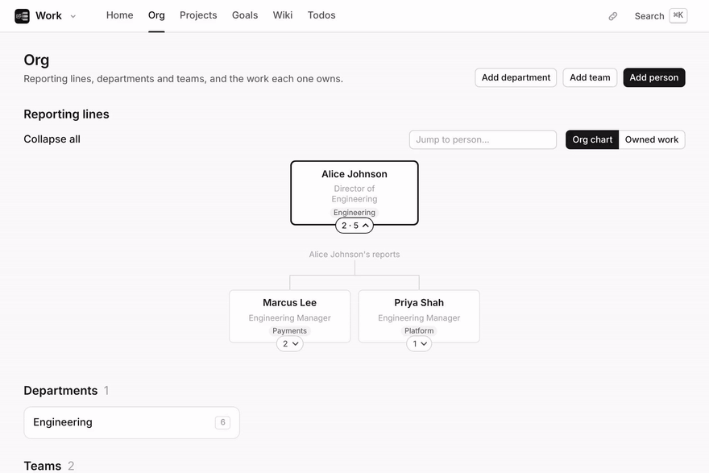
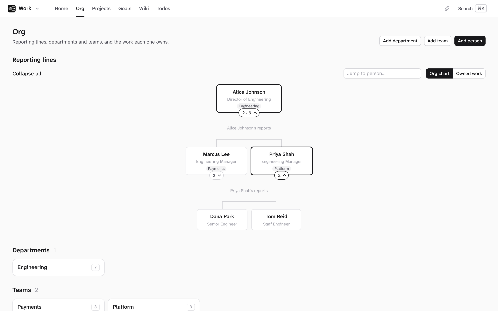
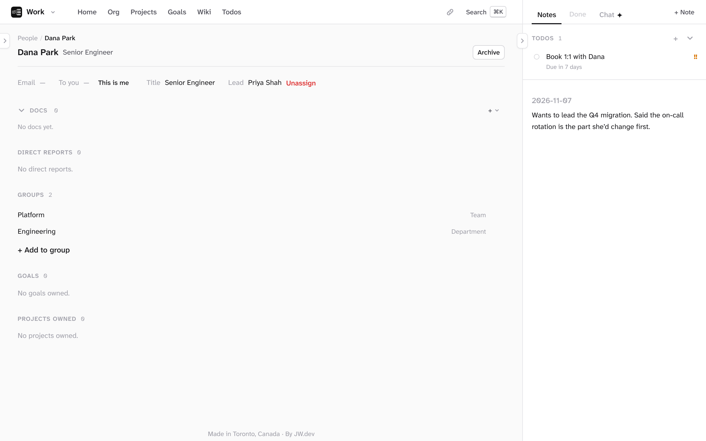
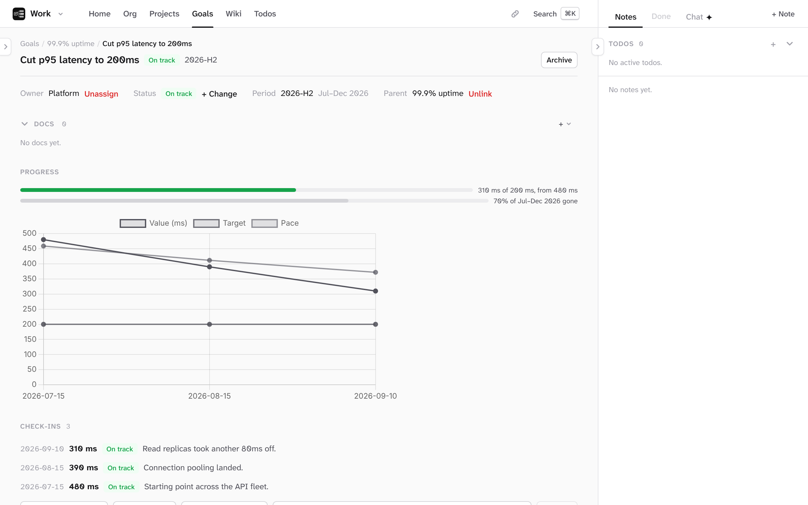
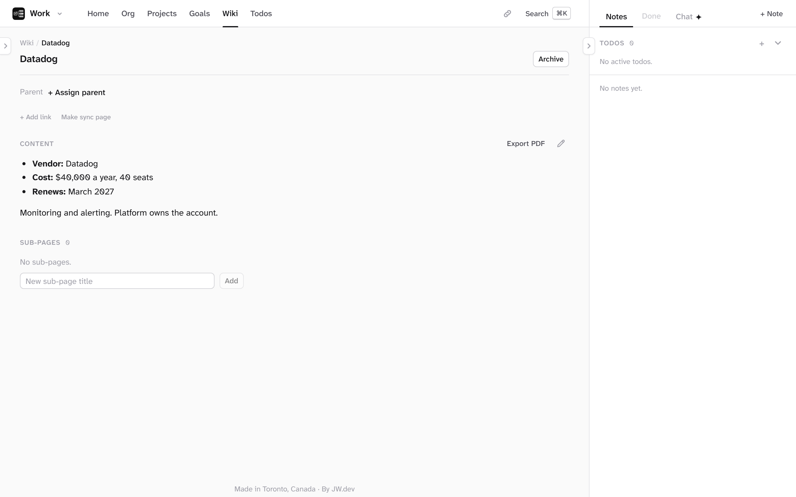
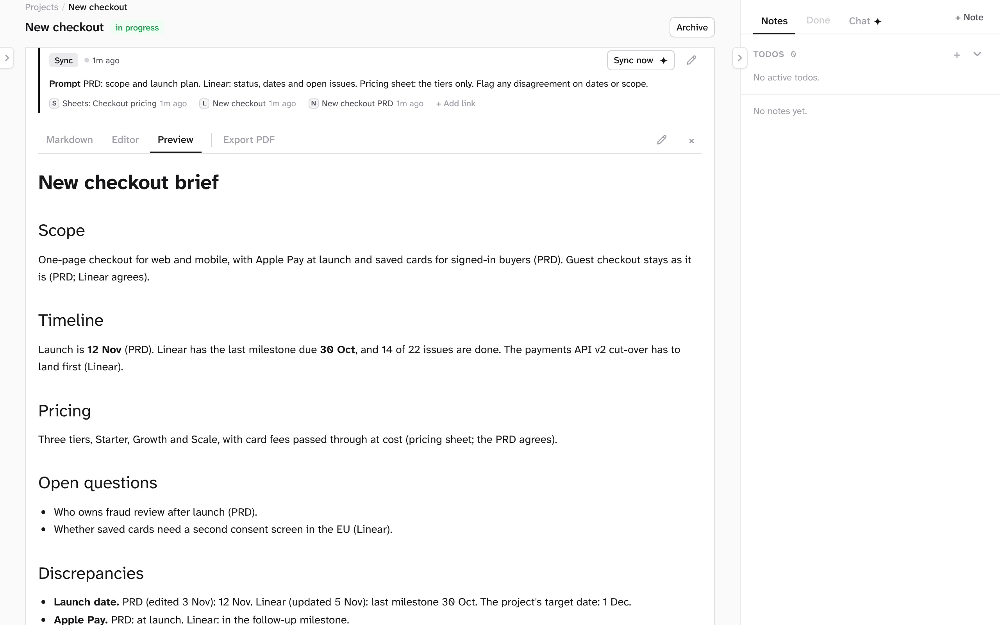
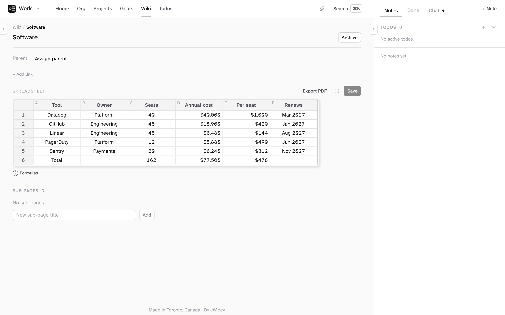
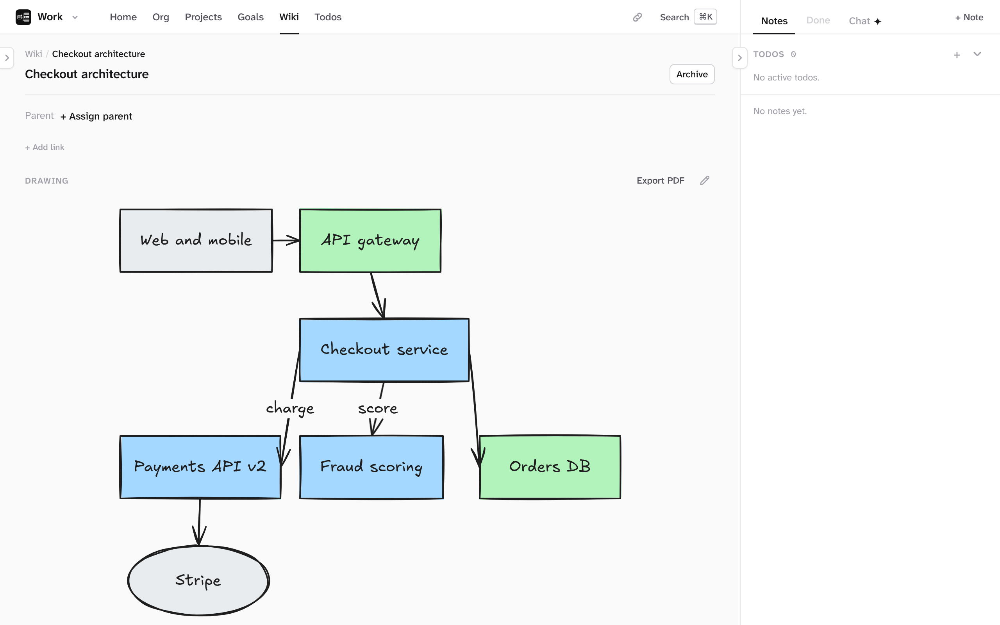
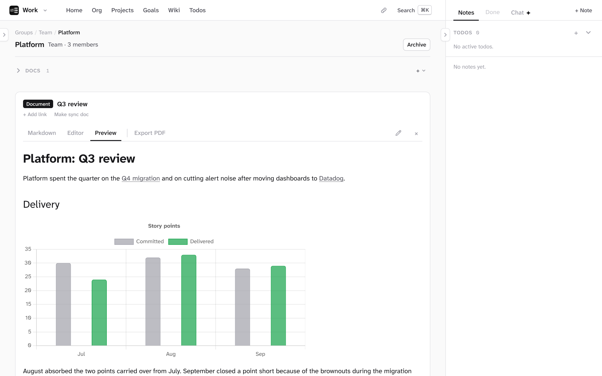
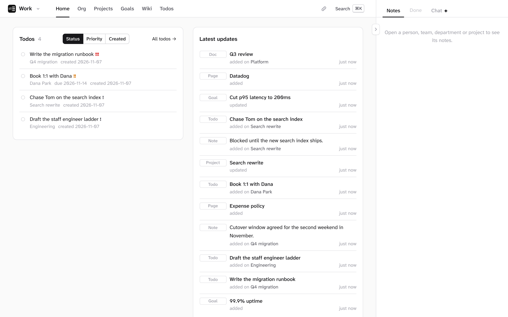

  

# Remry

**Your mind palace, kept by Claude.** Tell Claude who moved teams, what came up in a 1:1, where a
goal stands. Claude files it in a notebook on your own computer, and looks it up when you ask.

Remry is a local, structured notebook that Claude writes to over MCP. It's ready to use: no
templates, no plugins.

> **Get it:** [Mac (Apple silicon)](https://github.com/remry-ai/remry/releases/latest/download/Remry-macos-arm64.dmg) ·
> [Windows](https://github.com/remry-ai/remry/releases/latest/download/Remry-windows-x64-setup.exe),
> then connect Claude with [docs/INSTALL.md](docs/INSTALL.md).
> Remry is free; [Remry Pro](#remry-pro) adds AI assist in the app, Sync now, unlimited drawings, branding and opening it on other devices.
> More at [remry.ai](https://remry.ai).

## You carry a lot in your head

Who reports to whom, which team owns what, where each goal stands, why you chose that vendor, what
you promised after the last 1:1. Your team's tools don't hold your version of it. Remry does.

## How it works

**You talk, Claude files.** Say "Dana moved from Platform to Payments" and Claude makes the change.
No forms, and the app doesn't need to be open.

**It doesn't forget.** It keeps what you said, word for word, and Claude looks it up when you ask.

**It keeps the shape of things.** People have managers, projects have owners, goals have dated
check-ins. So "what depends on the payments API?" gets the same answer every time.

**Nothing leaves your computer.** Your notebooks live in a folder on your Mac or PC. No accounts, no
keys, no cloud. The app has no model of its own: Claude works on it from outside, and the AI
features inside the app run your own Claude Code.

## What using it looks like

### An org change

> **You:** Dana Park joined as a senior engineer, on Platform, reporting to Priya.

Claude adds Dana, sets her lead and team. For a reorg, edit the org chart by hand.

### After a 1:1

> **You:** Note that Dana wants to lead the migration. She'd change the on-call rotation first.
> Remind me to book a 1:1.

Both land in the panel beside Dana's page: the note dated, in your words, and the todo above it.
Months later, "what do I know about Dana?" returns her notes, todos and docs.

### Projects

> **You:** The search rewrite is blocked on the new index. Note it, and remind me to chase Tom.

Each project has a status: proposed, committed, in progress, blocked, done or abandoned. The
projects list puts every project on one timeline, coloured by status, and a peek shows a project in
the side panel without leaving the list.

### Goals with real numbers

> **You:** Platform's H2 goal is p95 latency under 200ms, from 480. We're at 310 now.

Each check-in adds to the history instead of overwriting it. `2026-H2` means July to December, so
the chart shows the pace you need, and a goal that trails it is flagged "Behind pace".

### A wiki that links up

> **You:** We pay Datadog $40k a year for 40 seats; it renews in March. Platform uses it for
> alerting.

A page's details go in a list at the top. Anything can link to anything, and mentioning a project in
a page adds a "Mentioned in" link to the project.

### A brief that stays current

> **You:** Make a Checkout brief from the PRD, the Linear project and the pricing sheet. Flag where
> they disagree.

Claude writes one view of the project, says where each point comes from, and ends with the
discrepancies: "Launch date. PRD: 12 Nov. Linear: 30 Oct." This is a sync doc. It keeps its sources
and a prompt saying what to take from each, so each source shows when it was last synced, and next
time Claude rewrites it the same way, or tells you what changed if you've edited it since. With
Remry Pro, **Sync now** has your Claude Code refresh it from the app.

### Spreadsheets and drawings, built in

> **You:** Put our software in a sheet: owner, seats, annual cost and cost per seat.

Any wiki page or doc can be a spreadsheet, for many records of one shape: formulas, number and
currency formats, and a full-screen view. Ask what you spend and Claude reads the totals back.

> **You:** Draw the checkout architecture.

Or a drawing: [Excalidraw](https://excalidraw.com), built in. Claude lays out the shapes and arrows;
open the drawing to move things around, full screen. Open `.excalidraw` files and Excalidraw links,
and share one as a link (encrypted, only when you ask). Each notebook has 3 free drawings; Remry Pro
removes the limit.

### Writing up the quarter

> **You:** Write up Platform's quarter as a doc: delivery and reliability, with charts.

Claude builds it from what's already in the notebook. Docs are markdown with charts drawn from
figures you give Claude, and like wiki pages, a doc can also be a spreadsheet or a drawing. Paste or drop images into a doc or wiki page, and export either to PDF
(branded with Remry Pro).

## The app

In Notion or Obsidian you start on a blank page and build the templates, databases and plugins
yourself. Remry has people, teams, projects, goals and docs built in, already linked. The app is
mostly for reading, in a browser pane beside Claude or as a desktop app.

- **Home:** open todos, recent changes, and a graph of everything linked to one thing.
- **Org:** the org chart, or each owner's projects and goals.
- **Projects:** every project on one timeline, with late stretches in red. Peek at one without
  leaving the list.
- **A page for everything:** each person, project, goal and page gets one: docs in the middle,
  todos and notes in the panel on the right, finished todos under Done.
- **Find anything:** press ⌘K and type a name. `/search budget review` searches the full text, and
  with Remry Pro, `/ask who owns billing?` asks your local Claude and answers with links.
- **Docs your way:** text with charts, a spreadsheet, or an Excalidraw drawing, on any person, team,
  project or goal.
- **Ask about this page** (Remry Pro): the side panel's Chat tab asks your local Claude about the
  page you're on.

Remry sits beside your other tools. Linear and Notion hold the team's version of things; Remry
holds yours. Ask Claude to bring a project in and it copies what matters to you, links back to the
source, and updates the same entry next time.

Work and home are separate notebooks, and nothing links across them. A work notebook knows titles,
leads, teams and goals; a home notebook knows birthdays and who is whose partner, parent or sibling.

Archiving takes a thing out of every list but keeps it and its history. Deleting removes everything
attached to it, so Claude offers to archive first.

## How is this different from…

**…your assistant's own memory?** It decides what to keep and summarises it. Remry keeps what you
said, where you can see it.

**…a memory server, like Basic Memory?** Those store free text. Remry knows what a person, project
and goal are, so it can answer "which goals are behind pace?" instead of searching for the word
"goal".

**…Obsidian, Notion or Apple Notes with an assistant connected?** There you build the structure and
file every page yourself. In Remry the structure is built in, and Claude does the filing.

**…Linear, Notion or Lattice?** Those hold the team's shared version. Remry holds yours, privately,
and links back to them.

## Privacy

- **Local only.** Notebooks are files on your computer, with hourly backups. No cloud sync.
- **No accounts.** Nothing to sign up for or log in to.
- **No model of its own.** Claude works on it from outside. The AI features in the app (Chat, `/ask`,
  Sync now) run your own Claude Code, or Copilot, on your computer; the app holds no keys.
- **Almost no requests.** The desktop app checks GitHub for updates and sends nothing about you.
  The only other one is a drawing you choose to share as an Excalidraw link, encrypted on your
  computer so Excalidraw can't read it.
- **Offline license key.** A Pro key is checked on your computer. No license server.

## Getting started

1. **Download the app** for [Mac (Apple silicon)](https://github.com/remry-ai/remry/releases/latest/download/Remry-macos-arm64.dmg)
   or [Windows](https://github.com/remry-ai/remry/releases/latest/download/Remry-windows-x64-setup.exe)
   ([all releases](https://github.com/remry-ai/remry/releases)). It brings everything it needs and
   updates itself.
2. **Connect Claude.** Add the Remry plugin in Cowork's Customize panel, or use the app's Claude
   menu. [docs/INSTALL.md](docs/INSTALL.md) has every route, Claude Code included.
3. **Tell Claude about your team.** Then open Remry and look.

More: [docs/CLI.md](docs/CLI.md) covers the `remry` command and the tools Claude uses;
[docs/DEVELOPMENT.md](docs/DEVELOPMENT.md) covers running from a clone and how releases work.

## Opening it from another device

Remry only answers on your computer. To open it from your phone or another laptop, use
[Tailscale](https://tailscale.com): your devices reach each other privately, with nothing opened to
the internet.

1. Install Tailscale on your computer and your phone, signed in to the same account.
2. In Remry, open the notebook menu → **Other devices** and choose **Turn on**. Remry checks that
   Tailscale is connected and has HTTPS certificates turned on (and says what to fix if not), shares
   itself on your tailnet with `tailscale serve`, and shows the address, like
   `https://my-mac.tail1234.ts.net/app`. Claude can do the same with `remoteAccess.set --tailscale true`.
3. Open that address on your phone.

Remry answers only that name, never public Funnel traffic. Every device on your tailnet can open
it, so use Tailscale's access rules if others share it. **Turn off** on the same page stops it.
Your computer has to be awake; turn on **Start at login** there (macOS) so Remry starts in the
background when you log in, with no window. Tailscale needs to open at login too.

## Backups

Remry copies each notebook every hour when something changed, and restoring saves your current
data first, so you can undo it. `remry backup install` keeps the copies running while nothing else
is open. Copies stay on this disk; Time Machine covers them against losing the disk.

## Remry Pro

Remry is free. **Remry Pro** is a yearly license that adds:

- **AI assist in the app:** the Chat tab, `/ask` in the finder, and Convert with Claude, all run
  by your own Claude Code (or Copilot).
- **Sync now:** rewrite a sync doc from its sources with one click.
- **Unlimited drawings:** each notebook has 3 free; Pro removes the limit.
- **Branding:** your organisation's colours and icon, on screen and in PDFs.
- **Other devices:** open Remry on your phone or another computer over Tailscale.

Full-text search, spreadsheets, PDF export and everything you do through Claude stay free.

It costs **$40 USD a year** ($50 CAD). That's the founding price, locked in while you renew; it goes
to $60 USD / $80 CAD later. **[Buy Remry Pro →](https://buy.stripe.com/bJefZg54rbNLa0H1sb0Jq01)**

Stripe runs the checkout, sales tax and receipts. Your license key is shown after you pay and
emailed to you; each renewal emails a new one. To activate it, choose **License** from the notebook
menu (the chevron beside the notebook name) and paste the key, or ask Claude to.

- **When a license lapses,** those features lock. Nothing else changes and no data is lost: your
  drawings stay editable (you just can't add a fourth), and a renewed key brings it all back.
- **The key is checked offline,** on your computer. Remry never contacts a license server.
- **Refunds:** ask within 30 days of buying. The refunded key stops working with the next update.
- **Lost your key?** Use the [contact form](https://jweatherby.dev/contact) with the email you
  bought it with.

## Status

Remry is made by one person, [jweatherby.dev](https://jweatherby.dev). The code is public, and it
changes often.

The desktop app runs on Apple silicon Macs and Windows (x64), and both are code-signed. To open
your notebook from your phone or another computer, turn on Tailscale sharing; see
[Opening it from another device](#opening-it-from-another-device).

## License

Remry is under the [Functional Source License, Version 1.1, MIT Future License](LICENSE.md)
(FSL-1.1-MIT), copyright 2026 jweatherby.dev. You may use, copy, modify and share it for any
purpose except offering a competing commercial product or service. Each release also becomes
available under the MIT license two years after it's published. Remry Pro keys are separate: the
license above covers the code, and a key unlocks Pro features in the app.
