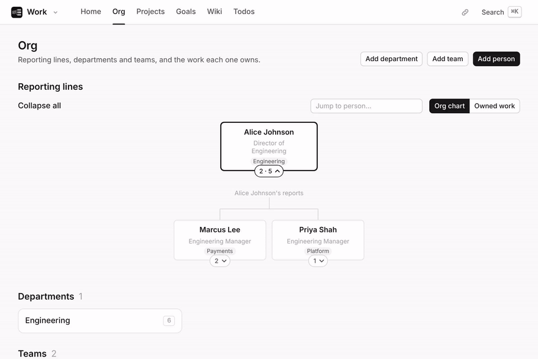
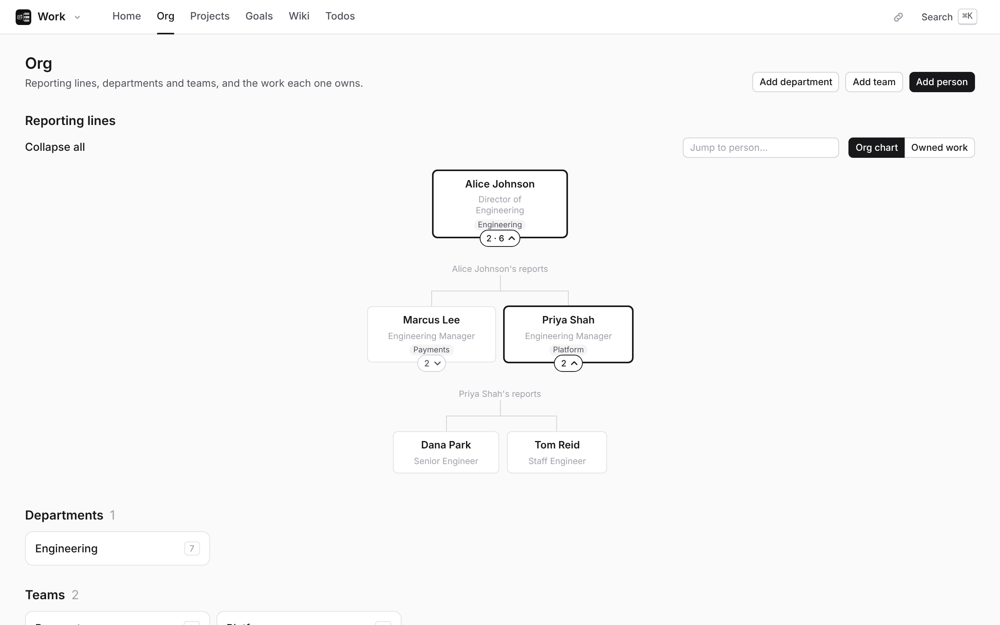
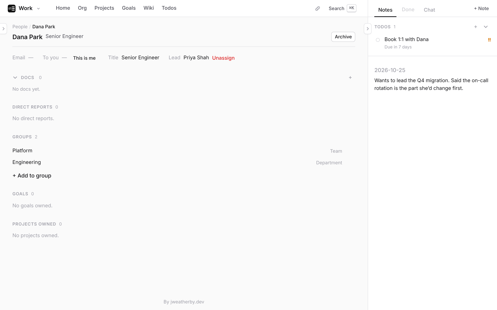
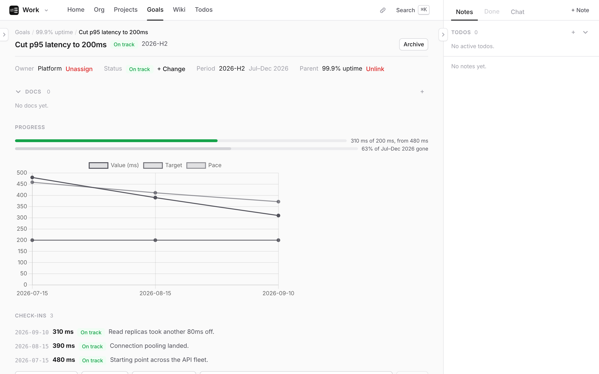
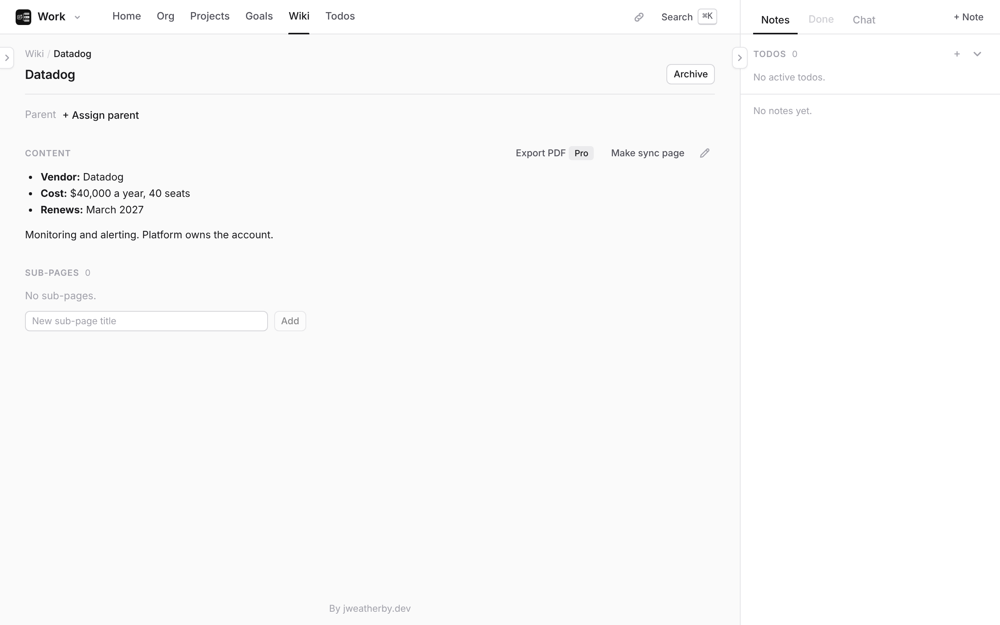
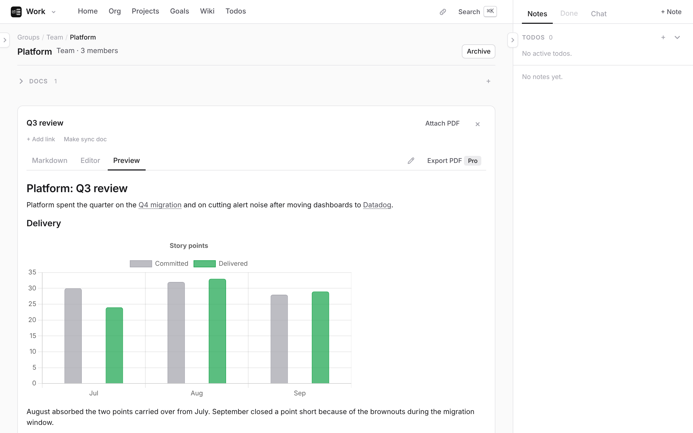
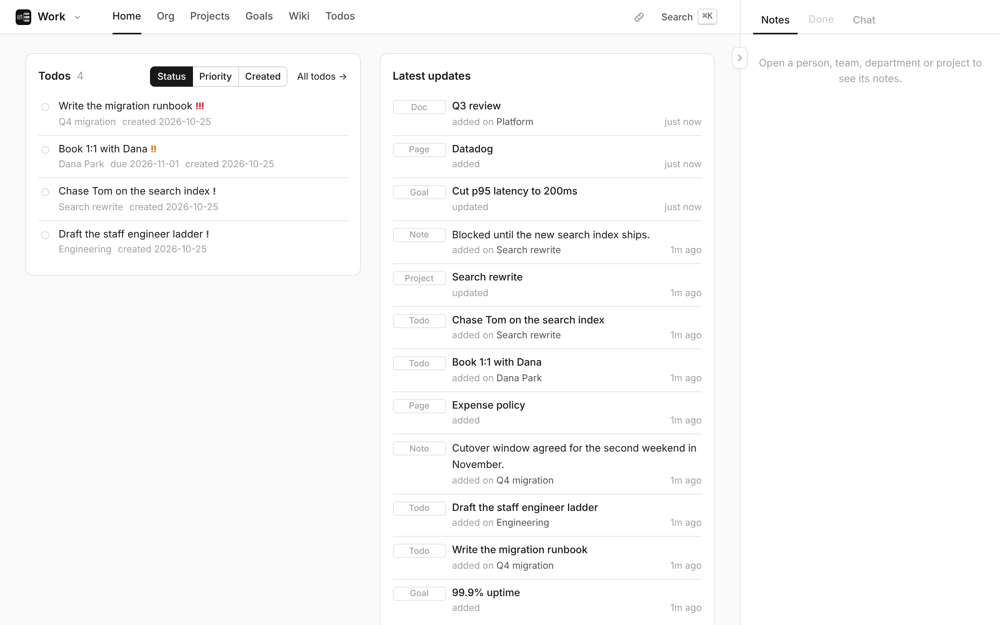

  

# Remry

A local, structured notebook that your AI assistant writes to over MCP. Works with Claude today.

Remry remembers what you would otherwise carry in your head: who reports to whom, which team owns
which project, where a goal stands this month, why you chose that vendor, what you promised to
follow up on. You tell Claude; Claude files it and looks it up when you ask; you read it in an app
on your own Mac.

> **Get it:** [Mac (Apple silicon)](https://github.com/remry-ai/remry/releases/latest/download/Remry-macos-arm64.dmg) ·
> [Windows](https://github.com/remry-ai/remry/releases/latest/download/Remry-windows-x64-setup.exe),
> then connect Claude with [docs/INSTALL.md](docs/INSTALL.md).
> Remry is free; [Remry Pro](#remry-pro) adds full-text search, branding and PDF export for $50 CAD a year.

## What you can use it for

- **Running a team.** Reporting lines, who sits on which team, what you agreed in the last 1:1.
- **Tracking the work.** Projects, owners, status, due dates, what blocks what, and your next steps.
- **Goals with real numbers.** A target, a figure each month, and a chart of how it went.
- **Remembering decisions.** Why you bought that tool, what it costs, when it renews.
- **Home life.** Family and friends, birthdays, and household records from expenses to recipes.
- **Writing it up.** A quarter in review or a summary for your boss, built from what is already there.

## How it works

**You talk, Claude files.** Say "Dana moved from Platform to Payments" and Claude makes the change.
There is no form to fill in, and the app does not need to be open.

**It does not forget.** What you tell it is stored as you said it, not summarised into a memory
that fades. Claude looks it up instead of trying to recall it.

**It keeps the shape of things.** A person has a manager, a project has an owner, a goal has dated
check-ins. So "what depends on the payments API?" gets the same answer every time, not a search
result.

**Nothing leaves your computer.** No accounts, no keys, no sync. The app never calls a language
model; Claude works on it from outside. The only request it makes is the desktop app asking GitHub
for updates.

**It sits beside your other tools.** Linear and Notion hold the team's version of things; Remry
holds yours. Ask Claude to bring a project in and it copies what matters to you, links back to the
source, and updates the same entry next time.

**Notebooks stay apart.** Work and home are separate notebooks, and nothing links across them. A
work notebook knows titles, leads, teams and goals; a home notebook knows birthdays and who is whose
partner, parent or sibling.

## What using it looks like

### An org change

> **You:** Dana Park joined as a senior engineer, on Platform, reporting to Alice.

Claude adds Dana, sets the reporting line and puts her on the team. You can also edit the org map
by hand, which is quicker for redrawing a reorganisation.

### After a 1:1

> **You:** Note that Dana wants to lead the migration — she'd change the on-call rotation first.
> Remind me to book a 1:1.

The note goes on Dana's page in your words, with the date, and the reminder becomes a todo. Months
later, "what do I know about Dana?" brings back her notes, todos, docs and goals.

### Projects and goals

> **You:** The search rewrite is blocked on the new index — push its target to March.

Each project has a status (proposed, committed, in progress, blocked, done or abandoned). The
projects list draws every project on one timeline, with late stretches in red, and a peek shows a
project's summary in the side panel without leaving the list.

> **You:** Platform's H2 goal is p95 latency under 200ms, from 480. We're at 310 now.

Each check-in adds to the goal's history instead of overwriting a number. `2026-H2` means July to
December, so the chart shows the pace you need, and a goal that trails it is flagged "Behind pace".

### A wiki that links up

> **You:** We pay Datadog $40k a year for 40 seats; it renews in March. Platform uses it for
> alerting.

Pages are markdown. Give pages of the same sort a kind of your own (software, with a vendor, a cost
and a renewal date) and they work as a filterable table. Anything can link to anything, and
mentioning a project in a page adds a "Mentioned in" link to the project.

### Writing it up

> **You:** Write up Platform's quarter as a doc — delivery and reliability, with charts.

Docs are markdown with charts drawn from figures you give Claude, in your branding's colours. Paste
or drop images into a doc or wiki page, and export either to PDF.

## The app

The app is mostly for reading, in a browser pane beside Claude or as a desktop app. The home screen
shows open todos, recent changes, and a graph of everything linked to one thing. The org map shows
reporting lines, or each owner's projects and goals. Every person, project, goal and page has its
own page: docs in the middle, todos and related things in the sidebar, notes on the right.

Press ⌘K to find anything by name. With Remry Pro, `/search budget review` searches the full text,
and `/ask who owns billing?` asks your local Claude and answers with links. The side panel's
**Chat** tab asks Claude about the page you are on.

Archiving takes a thing out of every list but keeps it and its history. Deleting removes everything
attached to it, so Claude offers to archive first.

## Backups

Remry copies each notebook every hour when something changed, and restoring saves your current
data first, so you can undo it. `remry backup install` keeps the copies running while nothing else
is open. Copies stay on this disk; Time Machine covers them against losing the disk.

## How is this different from…

**…your assistant's own memory?** It decides what to keep and summarises it. Remry keeps exactly
what you said, where you can see it.

**…a memory server, like Basic Memory?** Those store free text and links. Remry knows what a
person, project and goal are, and turns away input that doesn't fit. That is why it can answer
"which goals are behind pace?" instead of searching for the word "goal". It also has an app to read
it in.

**…Obsidian, Notion or Apple Notes with an assistant connected?** There you organise the pages.
Here you say what happened, and it is filed in the right place.

**…Linear, Notion or Lattice?** Those hold the team's shared version. Remry holds yours, privately,
and links back to them.

## Getting started

Download the desktop app for [Mac (Apple silicon)](https://github.com/remry-ai/remry/releases/latest/download/Remry-macos-arm64.dmg)
or [Windows](https://github.com/remry-ai/remry/releases/latest/download/Remry-windows-x64-setup.exe)
([all releases](https://github.com/remry-ai/remry/releases)). It brings everything it needs and
updates itself.

- **[docs/INSTALL.md](docs/INSTALL.md)**: install the app, then connect Claude Code, Cowork or
  Claude desktop.
- **[docs/CLI.md](docs/CLI.md)**: the `remry` command and the tools Claude uses.
- **[docs/DEVELOPMENT.md](docs/DEVELOPMENT.md)**: running from a clone, and how releases work.

## Remry Pro

Remry is free. **Remry Pro** is a yearly license that adds:

- **Full-text search** across notes, docs, wiki pages, todos and comments, and "what do I know
  about X" from Claude.
- **Branding:** your organisation's colours and icon, in the app and on what you print.
- **PDF export** of docs and wiki pages.

It costs **$50 CAD a year** ($40 USD) and renews until you cancel.
**[Buy Remry Pro →](https://buy.stripe.com/bJefZg54rbNLa0H1sb0Jq01)**

Stripe runs the checkout, sales tax and receipts. Your license key is shown after you pay and
emailed to you; each renewal emails a new one. To activate it, choose **License** from the notebook
menu (the chevron beside the notebook name) and paste the key, or ask Claude to.

- **When a license expires,** search, branding and PDF export lock. Nothing else changes and no
  data is lost; a renewed key brings it all back.
- **The key is checked offline,** on your computer. Remry never contacts a license server.
- **Refunds:** ask within 30 days. The refunded key stops working with the next update.
- **Lost your key?** Use the [contact form](https://jweatherby.dev/contact) with the email you
  bought it with.

## Status

Remry is one person's tool, built in the open. Expect it to change. Reports (branded write-ups) are
built but switched off while unfinished; use docs instead.

The desktop app runs on Apple silicon Macs and Windows (x64). The Windows installer isn't
code-signed yet, so Windows asks before opening it the first time; see
[docs/INSTALL.md](docs/INSTALL.md).
